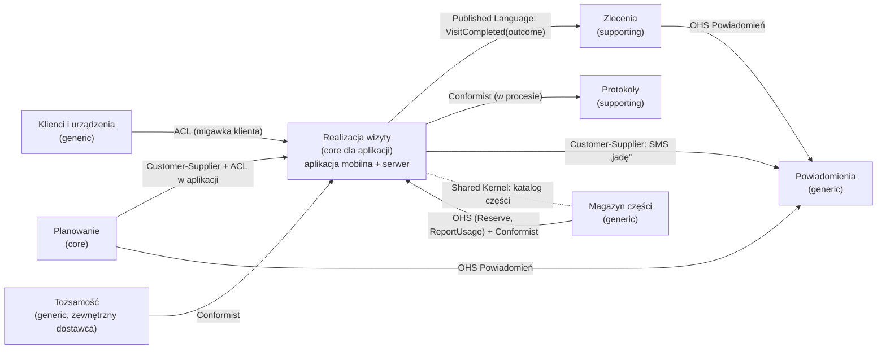

Nagrana odpowiedź LLM do dema (plan B) – do weryfikacji, nie wzorzec.

# Demo 08 · krok 5 – mapa kontekstów zaktualizowana przez LLM

Wejście: diff łatki `08-powiadomienie-klienta.patch` (komenda `NotifyCustomerEnRoute`, port
`ICustomerNotificationsGateway`, adapter `ApiCustomerNotificationsGateway`), `src/`, obecna
`docs/architecture/mapa-kontekstow.md`, prompt `docs/ai/prompty/06-mapa-kontekstow.md`.

## Odpowiedź LLM

Nowe wiersze tabeli relacji:

| Relacja (upstream → downstream) | Strategia | Uzasadnienie | Gdzie w kodzie aplikacji |
|---|---|---|---|
| Realizacja wizyty → Powiadomienia | Customer-Supplier | aplikacja technika wysyła żądanie SMS do Powiadomień, więc jest dostawcą komunikatu | `Infrastructure/Notifications/ApiCustomerNotificationsGateway`, port `ICustomerNotificationsGateway` |
| Realizacja wizyty ↔ Magazyn części | Shared Kernel | oba modele używają wspólnego katalogu części | `Domain/Shared/PartCatalog` |

Lista zmian:
1. Nowa relacja z Powiadomieniami – potwierdza ją `ApiCustomerNotificationsGateway.cs`.
2. Nowa relacja Shared Kernel z Magazynem – wspólny katalog części.
