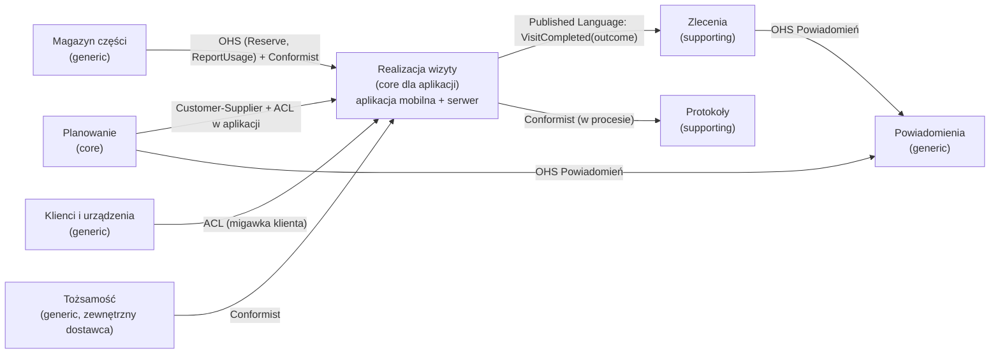

# Mapa kontekstów FieldService

Mapa autonomicznych modeli: kto się do kogo dostosowuje i jak się integrują. Granice wyznacza architektura systemu,
zespół aplikacji mobilnej je czyta i pilnuje ich w kodzie. Strzałka prowadzi od upstreamu do downstreamu; kierunek
logiczny wyznacza to, czyim językiem mówi komunikat, a nie to, kto go fizycznie wysyła.

## Moduły

| Moduł | Główne pytanie | Klasa problemu | Gdzie działa | Typ poddomeny |
|---|---|---|---|---|
| Realizacja wizyty | Co technik zrobił na tej wizycie i czy klient to potwierdził? | rywalizacja o zasoby (brygada + dyspozytor); na telefonie: praca okresowo podłączona | aplikacja mobilna (replika lokalna, offline) + serwer (źródło prawdy) | core (dla aplikacji) |
| Planowanie | Kto i kiedy jedzie do klienta? | rywalizacja o zasoby (grafik technika na dzień) | serwer, panel dyspozytora | core |
| Zlecenia | Czy sprawa klienta jest załatwiona i czy dotrzymaliśmy SLA? | CRUD (deskryptor zlecenia) + maszyna stanów zlecenia | serwer; w aplikacji model odczytu | supporting |
| Magazyn części | Czy mogę dostać tę część dla tej wizyty? | rywalizacja o zasoby (rezerwacja ostatniej sztuki) | serwer (źródło prawdy); w aplikacji komenda + model odczytu „auto technika” | generic (archetyp „Magazyn”) |
| Protokoły | Co wpisać do protokołu z wizyty? | transformata | aplikacja (offline, przed podpisem) | supporting |
| Klienci i urządzenia | Gdzie jest urządzenie i kto jest kontaktem? | CRUD | serwer (CRM); w aplikacji migawka | generic |
| Powiadomienia | Jak powiadomić klienta, że technik jedzie? | integracja | serwer | generic |
| Tożsamość | Kim jest zalogowany technik? | gotowy dostawca | zewnętrzny dostawca tożsamości | generic |

## Relacje

| Relacja (upstream → downstream) | Strategia | Uzasadnienie | Gdzie w kodzie aplikacji |
|---|---|---|---|
| Planowanie → Realizacja wizyty | Customer-Supplier + ACL w aplikacji | Realizacja może prosić o zmiany API planowania; ACL chroni model wizyty przed strukturami grafiku | `Infrastructure/Visits/VisitDtoMapper` (format API → `VisitSummary`, szczegóły → `Visit` + `VisitSnapshot`) |
| Realizacja wizyty → Zlecenia | Published Language: zdarzenie publiczne `VisitCompleted(outcome)` | Zlecenia same decydują o zamknięciu („zlecenie nie zamyka się samo”); zdarzenie niesie odpowiedź, nie szczegóły | zdarzenie domenowe `Domain/Visits/Events` `VisitCompleted`; wysyłki na serwer jeszcze brak w kodzie |
| Magazyn części → Realizacja wizyty | Open-Host Service Magazynu (komendy `Reserve`, `ReportUsage`) + Conformist po stronie aplikacji | generyk obsługuje wielu klientów (Zlecenia, Realizacja, Zakupy) → OHS z pragmatyczną komendą; konformizm wobec dobrego API generyka jest w porządku | `Infrastructure/Inventory/HttpInventoryGateway` (stan auta technika → `VanStockItem`); rezerwacji jeszcze brak w kodzie |
| Realizacja wizyty → Protokoły | Conformist (w procesie, w aplikacji) | transformata przyjmuje migawkę zakresu wizyty; jeden zespół, wspólny cykl wydań | `Domain/Protocols/VisitProtocolBuilder` (migawka `VisitScope` → `VisitProtocol`) |
| Klienci i urządzenia → Realizacja wizyty | ACL (migawka klienta w modelu odczytu) | dane klienta to migawka z innego źródła prawdy | `VisitSummary` (lista wizyt) i `CustomerSnapshot` w `VisitDetails` – migawki danych klienta |
| Tożsamość → wszystkie | Conformist | zewnętrzny standard, zmiany nie bolą | `Infrastructure/Auth/HttpAuthGateway` |
| Zlecenia, Planowanie → Powiadomienia | OHS Powiadomień (komenda „wyślij”) | generyk nie słucha zdarzeń wszystkich procesów | – (serwer) |

## Sygnały kontrolne

- Core (Realizacja, Planowanie) nie jest downstreamem modułu supporting.
- Brak łańcucha konformistów.
- Żaden moduł nie odpowiada na pytanie innego modułu (jedno źródło prawdy).
